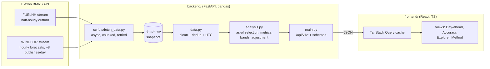

# Architecture and design notes

This document is for the technical reviewer. It covers how the system fits together, the decisions behind it, and what would change on the way to production.

## 1. System overview



**Runtime.** One process: FastAPI serves `/api/v1/*` and the static React build at `/`. The same image runs locally (`docker compose up`), on Heroku (`heroku.yml`), or split on Vercel (static build plus a Python function, see `vercel.json`).

**Request path.** The browser calls a typed fetch wrapper (`api/client.ts`). The response is cached by TanStack Query for the session, because the data is immutable. The FastAPI route validates input and calls `WindAnalytics`. That class runs pandas computations, memoised per deadline. `to_jsonable` converts the result, and the pydantic response model validates the contract.

## 2. The core algorithm: forecast selection without look-ahead

The product's correctness rests on one rule: **a decision may only use forecasts published before it was taken.**

For a target hour *t* and a cutoff *c(t)*:

```
forecast(t) = WINDFOR row with startTime == t and the greatest publishTime <= c(t)
```

- **Decision view.** *c(t)* is the auction deadline on the day before the UK delivery day containing *t*. The cutoffs are computed in vectorised form in local time and then localised, so they are correct on clock-change days. See `cutoffs_for_targets`.
- **Horizon view.** *c(t) = t − h*.

Both cases are a single `pd.merge_asof(left=targets, right=forecasts, left_on="cutoff", right_on="publish_time", by="start_time", direction="backward")`. This is O(n log n) and avoids Python loops. The join runs over about 20k forecast rows in milliseconds.

Edge cases covered by tests:

- A publish exactly at the cutoff counts as available.
- A missing forecast for *t* yields NaN. The join never borrows a neighbouring hour, because it is grouped by `start_time`.
- Revised FUELHH rows keep the latest publish.
- Rows with non-numeric generation are dropped.
- Clock-change delivery days have 23 or 25 hours.

## 3. Accuracy and uncertainty

| Quantity | Definition | Why |
|---|---|---|
| error | forecast − actual (MW) | Positive means a wind shortfall, so the desk is short and must buy back |
| MAE, RMSE, bias, nMAE | standard | Typical miss, penalty for large misses, systematic offset, scale-free comparison |
| P90 absolute error | 90th percentile of the absolute error | Practical sizing figure for a safety margin |
| 80% range | forecast − Q90(err) … forecast − Q10(err), with Q estimated on the *other* delivery days | Gives the desk a calibrated range rather than a single number |
| Coverage | share of actuals inside the range, computed leave-one-day-out | Shows the range is honest: 77.7% against an 80% target |
| Adjusted forecast | forecast × Σactual/Σforecast over days D−8 to D−2 | Removes the systematic bias using only data settled before the deadline |

**Resolution.** WINDFOR is hourly and FUELHH half-hourly. Metrics use the hourly timestamps present in both datasets, with no interpolation assumption. Daily energy uses each dataset at its native resolution: hourly MW × 1 h for the forecast and half-hourly MW × 0.5 h for the actuals.

**Known limitation.** The 80% range is calibrated within January, so for a given day it borrows information from later January days. The adjusted forecast does not have this issue. In production the range would be calibrated on a rolling window of past data only, and conditioned on lead time and forecast level, because errors grow with both. See the analysis by forecast level in section 7.

## 4. API design

- **Versioned prefix** (`/api/v1`). Future breaking changes go to `/v2` while v1 keeps working.
- **Explicit contract.** Pydantic models in `schemas.py` generate the OpenAPI docs at `/api/docs`. The frontend types in `api/types.ts` mirror them.
- **View-shaped endpoints** (`day-ahead`, `accuracy`, `series`) rather than raw table dumps. The payloads are small (about 10 KB gzipped), and the computation stays server-side, next to pandas.
- **Validation.** Malformed deadlines, out-of-scope dates and oversized ranges return `422` with a readable message. A missing snapshot returns `503`.
- **Caching.** Responses carry `Cache-Control: public, max-age=300`, which is safe because the snapshot is immutable. Results are memoised per deadline in-process.
- **Observability.** Requests are logged with status and latency, and a `Server-Timing` header is added. Data load time is logged at start-up. `/api/v1/health` serves the Docker health check and uptime monitors.

## 5. Frontend design

- **Server state** is held in TanStack Query: caching, deduplication, `keepPreviousData` for smooth day-to-day navigation, and retry. There is no global store, because the remaining UI state is small.
- **URL as state.** `tab`, `date` and `gate` live in the query string through `useUrlState`, so any view can be shared or bookmarked.
- **Time zones.** All wall-clock times are formatted in `Europe/London`. Calendar dates are formatted in UTC so they never shift. Both rules are tested.
- **Charts** use Recharts with concrete theme colours: SVG presentation attributes cannot reliably read CSS variables, so `useChartTheme` follows `prefers-color-scheme`.
- **Performance.** The Explorer slider is debounced (250 ms), large derived arrays are memoised, and animations are disabled on dense series.
- **Accessibility.** Controls are labelled, tabs use ARIA roles, the table supports keyboard navigation, and the layout is responsive down to phone width.

## 6. Testing and quality gates

| Layer | What is tested | Where |
|---|---|---|
| Analysis unit tests | Gate parsing, DST windows, cutoff mapping, as-of selection edge cases, cleaning, metrics, band orientation, trailing ratio | `backend/tests/test_analysis.py` |
| Service tests on synthetic data | Each forecast value encodes its publish time, so the selected publish is asserted exactly | `backend/tests/conftest.py`, `test_analysis.py` |
| API contract | Status codes, defaults, payload shape, headers, validation errors | `backend/tests/test_api.py` |
| Real-data invariants | No look-ahead, full coverage (31 days × 24 h) at three deadlines | `backend/tests/test_snapshot.py` |
| Frontend | Data merging, CSV export, formatting across GMT and BST, app shell loading and error states | `frontend/src/**/*.test.ts(x)` |
| CI | ruff lint and format, pytest, tsc, vitest, Vite build, Docker build plus smoke test | `.github/workflows/ci.yml` |

## 7. Supporting analysis (January 2026, 09:20 deadline)

| Forecast level (MW) | Mean error (MW) | Hours |
|---|---|---|
| 4,000–8,000 | +278 | 133 |
| 8,000–12,000 | +1,464 | 201 |
| 12,000–16,000 | +1,485 | 132 |
| > 16,000 | +2,816 | 271 |

The over-forecast grows with forecast level. That pattern is consistent with curtailment of wind for grid constraints on windy days, which removes energy from metered outturn but not from the forecast. A multiplicative correction suits this pattern better than an additive one. Tested alternatives with trailing windows:

| Correction | MAE (MW) |
|---|---|
| none | 2,022 |
| additive, 7-day mean | 1,629 |
| additive, 14-day mean | 1,534 |
| multiplicative, 7-day ratio (shipped) | 1,409 |

## 8. Trade-offs made for the MVP

| Decision | Alternative | Why |
|---|---|---|
| Ship a CSV snapshot in the repo | Live Elexon calls per request | The data scope is a fixed historical month. A snapshot gives fast, reproducible results and keeps working during Elexon outages. A refresh script exists. |
| pandas in-process | Database plus SQL | About 20k rows fit in memory and load in about 30 ms. A database adds operations work with no benefit at this scale. |
| One image serving UI and API | Separate frontend container | Simplest deploy on Heroku or any container host. Vercel uses the split model natively. |
| Hourly evaluation grid | Interpolating forecasts to half-hours | Avoids inventing data, and the choice is documented. |

## 9. Production roadmap

1. **Scheduled ingestion** (a cron or Celery beat job) into Postgres or TimescaleDB, idempotent on `(publish_time, start_time)`, with a data-freshness monitor and an alert when a WINDFOR publish is missed.
2. **Rolling, conditional calibration** of the range and the adjustment, by lead-time bucket and forecast level, plus a backtesting harness that reports pinball loss and coverage.
3. **Decision outputs.** Combine with the client's demand forecast to show the recommended buy volume, and price the cost of error using intraday and imbalance prices. That needs data beyond Elexon wind, which was out of scope here.
4. **Platform.** Authentication (SSO), multi-user saved views, OpenTelemetry tracing, and error tracking such as Sentry.
